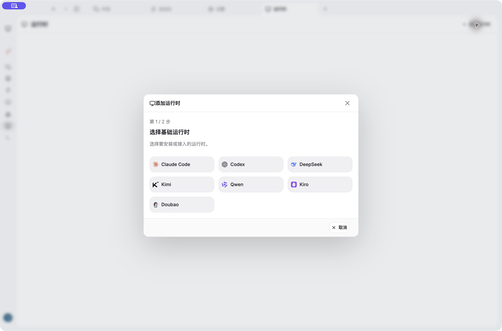

<!-- README_SYNC: source=working-tree; updated=2026-10-21 -->

**English** · [简体中文](README.zh-CN.md)

# Kuneco

**One desktop workspace for AI conversations, memory, browsing, and environments.**

Work with Claude Code, Codex, and DeepSeek across local and container environments, with shared memories of your preferences and project decisions.

[Star Kuneco](https://github.com/Lofelin/Kuneco) · [Report an issue](https://github.com/Lofelin/Kuneco/issues) · [Version 0.1.0](package.json)

[](https://github.com/Lofelin/Kuneco)
[](https://github.com/Lofelin/Kuneco/forks)
[](https://github.com/Lofelin/Kuneco/issues)



[Automation setup](docs/operations/media/automation.jpg) · [Preferences](docs/operations/media/preferences.jpg)

*Actual desktop interface captures.*

## Features

| Capability | What you can do |
| --- | --- |
| Multiple AI runtimes | Use Claude Code and Codex, or configure the DeepSeek API in managed containers. Organize conversations by account and environment. |
| Memory library | Extract preferences, facts, and project decisions, then recall them across runtimes with sources and revision history. |
| Separate environments | Manage local and Docker workspaces with their own runtimes, sign-ins, and working data. |
| Built-in browser | Browse within the workspace. Managed environments use a separate Chromium container and keep uploads and downloads inside the environment. |
| Proxy management | Import proxies and subscription nodes, save multiple configurations per environment, and verify the exit before connecting. |
| Scheduled conversations | Send preset questions on a schedule, choose a runtime, save replies, and inspect execution status. |

Runtime availability depends on installation and authentication in the selected environment. An entry in the picker does not mean it is ready to use.

### Shared memory across runtimes

Open the memory library to manage information worth keeping from your conversations. For example, once a project's documentation language has been successfully extracted as a memory, another runtime can recall that decision in a later conversation within the same account, environment, and applicable project.

- **Automatic extraction**: collect memories from successfully completed conversations, retain user excerpts as sources, and merge sources for duplicate content.
- **Relevant recall**: select related, enabled memories before a request. Mark important entries to always be read.
- **Traceable and editable**: search, filter, edit, enable or disable entries, and inspect revisions. Sources start collapsed; expand one to read the original excerpt or open its conversation.
- **Your decisions stay in control**: resolve conflicts between automatic extraction and manually maintained content, and restore removed memories when needed.

Memories are scoped by account and environment; project-specific entries also match the project path. Extraction and recall can be disabled independently. See the [memory library guide](docs/operations/memory-library.md).

## Everyday workflow

1. **Choose an environment**: work locally or in managed Docker. Initialize the container engine when prompted on first use.
2. **Prepare a runtime**: detect, install, or configure an AI tool, then complete provider sign-in or API setup. Kuneco sign-in and runtime authentication are separate.
3. **Start working**: choose a connection mode and switch between conversations, browsing, and the console. Proxy mode requires exit verification first.
4. **Pick up where you left off**: resume conversations, review extracted memories, or schedule recurring questions.

Scheduled conversations require the app to keep running. Closing it stops execution without catch-up runs; switching accounts or environments pauses tasks until their original environment returns.

## Run from source

The current development workflow targets **macOS**. Packaged releases and Windows/Linux support are not yet validated. You need dependency-compatible Node.js / npm and macOS Command Line Tools, plus Go 1.26 and PostgreSQL for the local account service.

```bash
git clone https://github.com/Lofelin/Kuneco.git
cd Kuneco
npm ci
cp -n backend/.env.example backend/.env
chmod 600 backend/.env
```

Create a PostgreSQL database, set `DATABASE_URL` in `backend/.env`, then launch:

```bash
npm start
```

The launcher builds the UI and starts or reuses the account service, which continues running after the desktop window closes. Set `WORKSPACE_ACCOUNT_SERVER_URL` to use an existing remote service. See the [account service guide](backend/README.md) for database configuration and Google sign-in details.

## Data and connection boundaries

- **Local memory storage**: memories are encrypted on this device and do not sync across devices. Extraction makes additional model requests, and recalled content is sent to the selected runtime with your conversation.
- **Environment-specific credentials**: runtime credentials stay in their environment; host sign-ins are not copied automatically. CLIs launched directly in the console do not automatically use the shared memory service.
- **Proxy failures block forwarding**: proxy mode does not fall back to direct access. Direct and automatic modes, where supported locally, are explicit choices; managed container browsing does not fall back to direct access. These controls are not a system-wide firewall, and the account service uses a separate connection.

## Documentation and development

The desktop app uses Electron, JavaScript, and Web Awesome. The account service uses Go and PostgreSQL; managed environments use Docker / Colima / Lima.

| Command | Purpose |
| --- | --- |
| `npm run check` | Build assets and check JavaScript syntax |
| `npm test` | Unit and contract tests |
| `npm run test:desktop` | Desktop acceptance; requires a graphical session |
| `npm run backend:test` | Go tests with race detection |
| `npm run test:docker` | Container and network integration checks; requires the container engine |

Backend integration tests need database configuration. Passing builds and unit tests does not establish that real model requests or provider sign-in work.

[Memory library](docs/operations/memory-library.md) · [Container browser](docs/architecture/container-browser.md) · [Proxy configuration](docs/operations/subscription-proxies.md) · [Repository layout](docs/architecture/repository-layout.md) · [Development conventions](AGENTS.md)

[Open an issue](https://github.com/Lofelin/Kuneco/issues) with your environment and reproduction steps. Remove credentials and private content from logs before sharing them.

Active development. The repository has no project-level `LICENSE`; dependencies and third-party assets retain their respective licenses.
