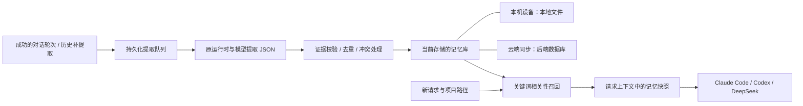

# 统一记忆服务（当前实现）

Kuneco 通过 `MemoryRepository` 统一访问记忆，并提供“本机设备 / 云端同步”两种存储模式，默认本机设备。本机模式以本地文件为权威数据；云端模式以后端数据库为权威数据。`MemoryService` 处理提取任务，Claude Code、Codex 和 DeepSeek 共用同一套提取与召回机制；账号、环境和项目范围继续隔离。

## 提取

- 每轮回复成功结束后入队；成功的自动化请求也可入队。后台在没有前台对话或自动化运行时串行执行。
- 提取器使用原运行时和模型，从本轮用户文本提取长期偏好、约定、决策、事实和经验；助手回复仅作理解上下文。
- 使用独立临时工作目录，限制工具调用，要求返回结构化 JSON。最多 8 条候选，需提供用户原文证据与置信度；置信度低于 0.85 不入库。
- 当前每轮最多保留用户文本前 12000 字符、助手文本前 6000 字符供提取，不主动读取附件。
- 历史补提取由“设置 → 智能 → 记忆 → 提取历史记忆”发起；请求只持久化后台任务并立即返回。后台再扫描当前已保存并加载的历史会话、分批排队并跟踪完成，跳过错误、中断和未回复轮次。已存在任务不重复入队；失败可单独重试。

## 保存与修订

- 本机设备模式使用 `memory-local.bin`，记忆、来源修订、设置、提取队列均不调用记忆后端接口。现有 `memory-library.bin` 首次仅复制到本机库，原文件保留。
- 云端同步模式使用后端 PostgreSQL 的 `memory_states` 表，按账号、环境保存记忆、来源修订、设置、提取队列和迁移标记。载荷使用后端现有 AES-GCM 密钥加密，身份来自服务端登录会话。
- `GET/PUT /v1/me/memories?environment=…` 采用范围修订号与数据库事务锁；旧版本写入返回 409，客户端重新读取后重算操作。手动条目修订冲突仍要求重新打开。
- 云端模式的本机 `memory-cache.bin` 仅保存已同步缓存及离线待上传轮次；所有本机文件均使用系统加密能力保护和原子替换。
- 存储选择独立保存在本机 `memory-storage.bin`，按账号与环境隔离。没有明确选择时始终默认本机设备，已有云端缓存不会自动开启同步。
- 两处记忆分别保留。切换到云端不会自动上传本机内容；需另点“上传本机记忆”，明确上传记忆、来源、修订与提取任务。同 ID 已有记录保留云端版本，本机原数据保留。切回本机不会删除已有云端记录。
- 云端多设备通过版本竞争领取 120 秒提取租约，过期后可以重新领取；旧执行器不能提交结果或重置新执行器的状态。本机模式恢复未完成任务时不访问后端。
- 每条记忆保存标题、内容、类型、主题键、关键词、启用状态、项目范围，以及来源和修订历史。
- 相同内容合并来源；相同主题的新约定可以修订自动记忆。手动保护、版本不匹配、停用记忆以及历史旧来源对更新记忆的修改进入待处理冲突。
- 移除为软删除，提取不会自动复活已移除内容。手动编辑和冲突处理保留修订记录。
- 提取成功后清除队列中的用户和助手文本，保留记忆的必要原文证据与来源标识。失败任务保留输入以便重试。
- 选择云端同步后，相同账号、相同环境标识在多设备间共享后端数据。断网时读取最近同步的缓存，新的成功轮次先写入本机待上传队列，联网后幂等上传。离线云端手动修改不会被报告为保存成功。
- 模型提取和回答时，必要文本仍会发送至所选运行时使用的模型服务。
- 存储选择只控制记忆，不控制聊天记录原有同步；本机设备模式也不意味着当前模型运行在本机。

## 跨会话使用

- 每次请求发送前，按当前账号、环境和项目查找已启用且 active 的记忆，生成本次请求快照。
- 使用 BM25 关键词检索与本机 384 维多语言语义向量检索，按 RRF（k=60）融合；语义阈值为 0.5。未准备模型、编码失败或超过 2.5 秒时明确回退到关键词召回。首次冷启动可能触发降级，索引在后台继续准备。未引入远程向量数据库或外部 embedding API。
- 固定记忆优先，通用偏好可补充召回。默认最多 8 条、6000 字符预算；设置可调整，完整条目超过预算时跳过。
- `withMemory` 把 id、revision、layer、title、content 及派生摘要的 memberRefs 序列化后附到请求前，供所有已接入运行时使用。它要求以当前明确指令为准。
- 修改影响后续请求，已发送的历史上下文仍保留。仅通过 Kuneco 发出的请求使用该共享记忆；独立运行 CLI 不会自动连接此服务。

存储路由：`src/features/memory/memory-repository.mjs`；同步实现：`src/features/memory/memory-sync-store.mjs`；后端实现：`backend/internal/server/memories.go`。

主要源码：`src/features/memory/memory-service.mjs`、`memory-store.mjs`、`memory-extraction.mjs`、`memory-runtime.mjs`、`memory-search.mjs`、`memory-history.mjs`；主进程接线在 `src/app/main.mjs`。

## 分层与批量判断

- L0 保留原文证据、会话/轮次指针；完整原始聊天仍由聊天存储管理。L1 是可手动管理的原子记忆。
- L2 根据明确的 scene 或项目分组，将至少两条有效原子记忆组合成场景摘要；最多 12 条、3000 字符。L3 只组合人工确认/置顶或至少两轮重复的明确全局偏好，最多 8 条、2400 字符。均保留完整成员事实，不截断正文、不推断画像。
- 派生层按当前有效成员及其修订号即时重建，不额外上传或另存陈旧摘要。移除、停用或修改后，派生结果立即变化。异步召回返回前再次检查存储位置和成员修订，过期快照不注入。
- 每轮先提取最多 8 个候选并校验用户原文，再用混合检索为每条取最多 5 个同范围候选（含墓碑），通过原运行时/模型的一次批量判断处理 store/merge/update/skip。完全相同内容可确定性处理，无候选的单条直接存储。
- 判断只能引用提供的 ID/修订或本批前序索引；非法结果整体失败，不部分落库。人工保护、停用和并发修订仍由存储层转成待处理冲突，软删除不会自动复活。
- 本机语义模型使用固定版本 Xenova/paraphrase-multilingual-MiniLM-L12-v2（q8 CPU）。设置中的「准备本机模型」仅下载约 135 MB 静态文件，校验固定大小与 SHA-256；不自动下载。推理 worker 禁止网络 fetch，向量和查询不发送 embedding 服务。
- 模型目录为 userData/memory-models；派生向量缓存 memory-index.bin 通过系统加密原子保存，按账号、环境、存储模式与内容哈希隔离，最多 5000 条。向量缓存不进入云端快照。设置显示混合/关键词召回状态及降级原因。
- 可通过记忆库「分层」查看 L0–L3 与成员；派生层只读，仍在原子记忆上管理来源、修订和冲突。

## 历史批处理的执行边界

容器中的提取器通过 `memory-process.mjs` 在实际启动运行时的 worker 内创建专用临时目录；直连任务有独立 `/tmp`，不能依赖代理 worker 中提前创建的目录。固定 Node 启动器以参数传递命令与目录，原文走 stdin，不经 shell；退出时只清理空目录。

新候选即使只有一条且没有既有候选，也须经过批量判断的长期价值检查。测试/验收口令、当前验收项目的一次性产物和单次技能/工具调用要求不进入长期记忆；明确长期业务约定仍可保存。具体同名主题（归一化标题至少 8 字、类型相同）的软删除墓碑也阻止模型换键重新创建旧主题；恢复通过用户手动操作完成。

## 历史后台任务与通知

`MemoryHistoryTasks` 将扫描、排队和完成跟踪从发起 IPC 请求中移出。`memory-history-tasks.bin` 仅在本机加密保存账号、环境、存储模式、预期轮次 ID 与任务进度，不另存会话正文，也不进入云端快照。

任务状态区分扫描、排队、运行、暂停、完成、有失败的完成和取消。来源暂不可用时暂停而非误报结束；账号、环境或存储模式切换后暂停原任务，返回对应范围后继续。重启后按稳定轮次 ID 恢复未排队的部分，已接受的轮次不重复创建。

任务结束写入待通知状态，由主进程向前端发出完成事件。全局前端监听器遵守现有通知设置，离开记忆设置后也能显示成功、失败或取消统计；通知确认单独持久化，重载后可补发未确认通知，当前窗口内不会因确认失败反复弹出。通知不切换页面、打开弹窗或抢占焦点。

记忆列表使用全局 app-table 的内部滚动与 sticky 表头；表头与页面同底色，无额外色块。来源列只读取固定运行时品牌目录，不显示手动/自动维护方式或用户自定义名称；没有运行时来源时用缺失占位符，维护方式仍保留在来源与修订详情中。
